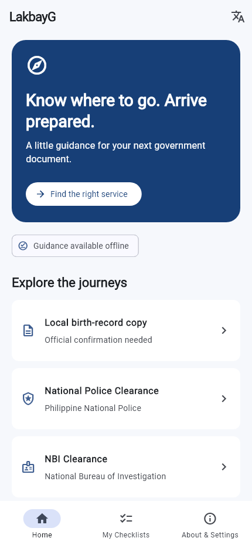
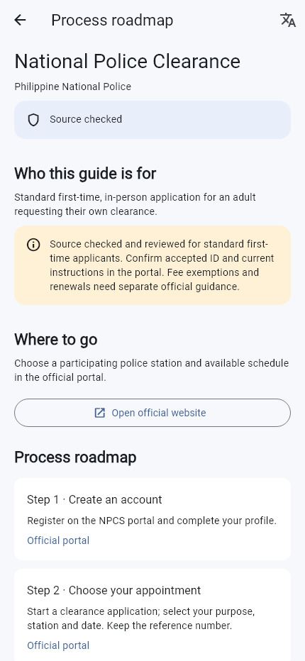

# LakbayG (Lakbay Gobyerno) — Project documentation

## Problem, purpose and users

First-time or infrequent applicants can confuse document types, agencies, requirements and processing locations. LakbayG helps users identify a supported service and prepare before a visit. Students are the primary pilot audience. Anecdotal experiences motivate the prototype; reduced real-world delay has not been established.

## Objectives and features

1. Guide users to a supported service using explicit answers and deterministic rules; uncertain answers get official referrals.
2. Present source-linked offline roadmaps with checked dates and defined applicant scope.
3. Save per-service readiness checklists on the device.

English and Filipino are supported throughout. Language can change during the questionnaire without losing answers. The Taal journey is an explicit verification-pending referral; PNP and NBI demonstrate complete standard first-time workflows.

## Screen flow

Language choice → Home → questionnaire → match or referral → roadmap → checklist. The bottom navigation provides Home, My Checklists, and About & Settings. Android Back returns within questionnaire history before leaving it. Resetting a checklist asks for confirmation.

## Tools and architecture

Flutter/Dart, Material 3, ChangeNotifier, Navigator, bundled JSON, generated ARB localization, SQLite/sqflite and url_launcher. Domain logic is independent of screen layout. The content repository validates the dataset at startup. SQLite holds checklist selections and language only. Preparation state updates in the UI after successful storage, and storage failure displays an error. Initial loading failures offer retry without deleting data.

No personal information is requested. Checklist state is local and removed when app data is cleared. One checklist per service is supported. App updates retain matching stable requirement IDs; changed requirement meanings require new identifiers. No network service or backend is deployed.

## Screenshots

The following files are generated by the widget test from actual Flutter rendering. They are not Android-device screenshots.

## Limitations and release gates

Team source and Filipino translation reviews for PNP and NBI standard first-time procedures are complete. Taal remains an intentional referral pending a current municipal charter, and connected-device usability sessions are scheduled before the final defense. No processing time, office availability, eligibility, or successful issuance is guaranteed.

## Team participation

| No. | Member Name | Role | Contributions |
|---|---|---|---|
| 1 | **Luke** | Team Leader & Technical Lead | System architecture, deterministic questionnaire engine, SQLite persistence (`sqflite`), Android APK build & verification, automated test suite, live demonstration |
| 2 | **Lordy** | UI/UX & Localization Lead | Material 3 responsive interface, small-screen & 200% font-scaling accessibility checks, Filipino (`app_fil.arb` & `catalog.json`) translation review, presentation slides |
| 3 | **Hans** | QA, Content & Research Lead | Official Citizen's Charter & portal verification (PNP, NBI, Taal), source register audit, usability test facilitation, project documentation & defense preparation |

## Submission checklist

Complete source and lockfile, working Android build, current source register, test evidence, screenshots, presentation, actual member contributions and a rehearsed live demonstration. Instructor approval is recorded as confirmed by the user. The four-week schedule starts at the team's chosen kickoff.
