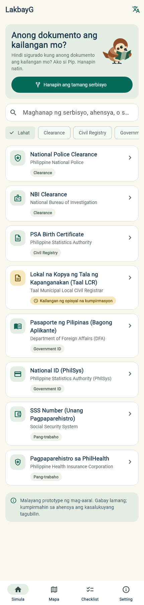

# LakbayG — Project documentation

## Problem, purpose and users

First-time or infrequent applicants can confuse document types, agencies, requirements, and processing locations. LakbayG helps users identify a supported service, understand key fees and valid IDs, and prepare steps, appointment details, and checklists offline before a visit. Students are the primary pilot audience.

## Objectives and features

1. **Need-First Service Navigator:** Guide users to 8 supported government services using explicit answers and deterministic rules; uncertain answers receive side-by-side comparisons and recommended guides.
2. **Interactive Process Roadmap:** Present source-linked offline roadmaps with checkable step progress, quick facts (fee, processing time, validity), accepted valid IDs, practical tips, and official references.
3. **Document Readiness & Appointment Tracker:** Save per-service requirement checklists, user-added custom items, and local appointment details (branch, date, reference number, notes) in SQLite on the device.

English and Filipino are supported throughout. Language can change during the questionnaire without losing answers. The Taal Civil Registrar journey is an explicit verification-pending referral; PNP, NBI, PSA Birth Certificate, DFA Passport, PhilSys National ID, SSS, and PhilHealth provide complete standard first-time workflows.

## Screen flow

Language choice → Home (Hero + Search + Category Filter + Resume) → Need-First Navigator → Match or Comparison Referral → Interactive Guide (Step by step / What to bring + Application Tracker) ↔ Office Map & Directory (21 Batangas & Laguna offices, optional GPS distance, Google Maps directions, and one-tap "Use as my branch"). Bottom navigation provides Home, Map, Checklists, and Settings. Android Back returns within questionnaire history before leaving it. Resetting a checklist asks for confirmation.

## Tools and architecture

Flutter/Dart, Material 3, ChangeNotifier, Navigator, bundled JSON, generated ARB localization, SQLite/sqflite (schema v2 with `onUpgrade`), `flutter_map` + `latlong2` (OpenStreetMap), `geolocator` (optional GPS), and `url_launcher`. Domain logic (`lib/domain.dart`) is independent of screen layout. The content repository validates the dataset at startup. SQLite (`lib/storage.dart`) holds checklist selections, completed steps, custom items, local appointment details, and language only. Preparation state updates in the UI after serialized storage writes, and storage failure displays an error.

No personal information is transmitted. All progress is local and removed when app data is cleared. No network service or backend is deployed.

## Screenshots

The following files are generated by the widget test from actual Flutter rendering:

## Limitations and release gates

Current Taal copy-issuance requirements and office directions still need official confirmation. All Filipino content needs a second human review. Campus usability and class rehearsal require real participants and remain pending. No processing time, office availability, eligibility, or successful issuance is guaranteed.

## Team participation

Designate a leader. Suggested primary responsibilities: interface/localization; navigation/content; persistence/testing. Every member must participate in planning, testing, documentation, and presentation and review another member's work. Fill in actual names and contributions before submission.

## Submission checklist

Complete source and lockfile, working Android build, current source register, test evidence, screenshots, presentation, actual member contributions, and a rehearsed live demonstration.
